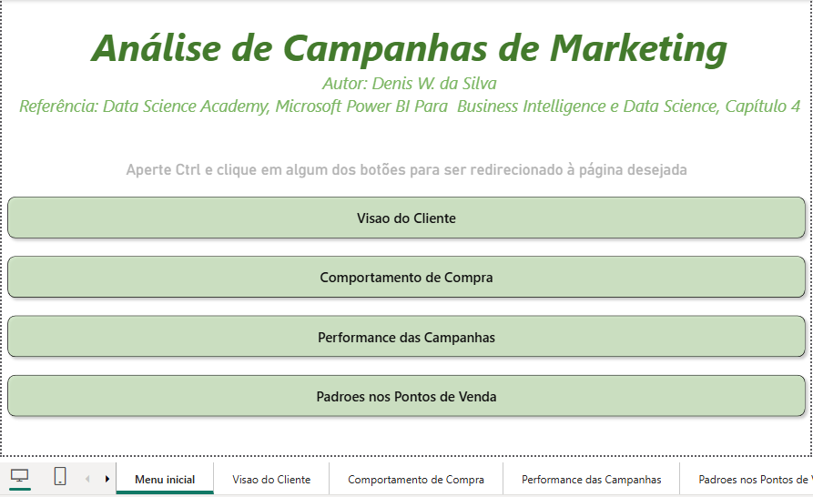
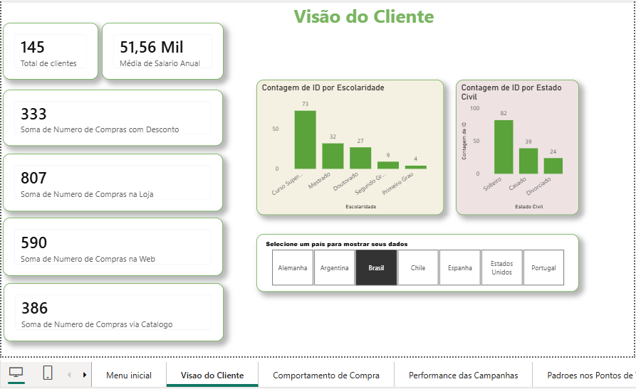
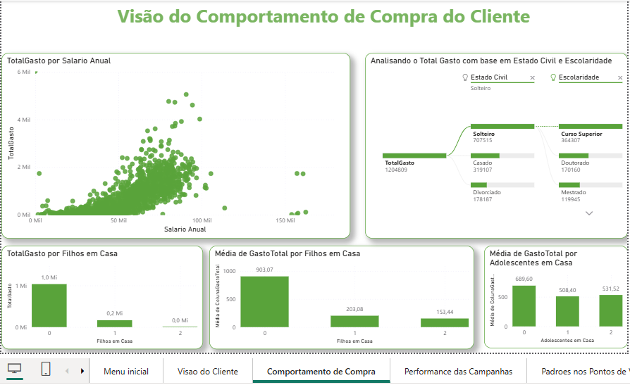
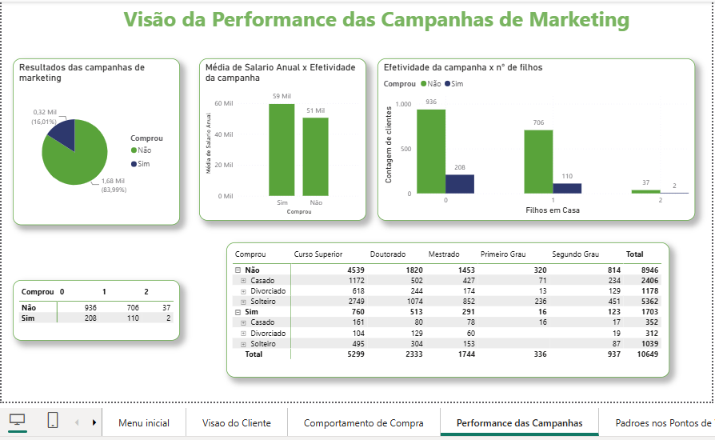
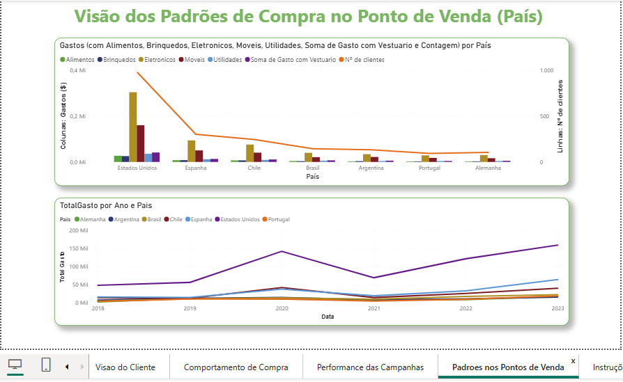

# Análise de Campanhas de Marketing

Relatório desenvolvido por Denis W. da Silva no **Microsoft Power BI** para análise do perfil dos clientes, comportamento de compra, desempenho das campanhas de marketing e padrões de consumo nos diferentes mercados. A elaboração deste projeto foi inspirada no Capítulo 4 do curso _Microsoft Power BI Para Business Intelligence e Data Science_, da Data Science Academy (DSA).

## Visualizações

### 1. Menu Inicial

Apresenta a capa do projeto e os botões de navegação que permitem acessar as diferentes páginas de análise.



### 2. Visão do Cliente

Apresenta indicadores gerais da base de clientes, perfil demográfico e distribuição geográfica.



### 3. Comportamento de Compra do Cliente

Explora a relação entre renda e consumo, os padrões de gastos conforme a estrutura familiar e a distribuição das compras entre diferentes perfis de clientes.



### 4. Performance das Campanhas de Marketing

Analisa a adesão dos clientes às campanhas de marketing e sua relação com características demográficas e familiares.



### 5. Padrões de Compra no Ponto de Venda

Compara os gastos por categoria de produto e a quantidade de clientes entre os países, além de apresentar a evolução temporal do consumo nos diferentes mercados.



## Objetivos

O relatório foi desenvolvido para explorar quatro perspectivas de negócio:

- **Visão do Cliente:** análise do perfil demográfico e distribuição geográfica dos clientes.
- **Comportamento de Compra do Cliente:** investigação dos padrões de consumo e sua relação com renda e estrutura familiar.
- **Performance das Campanhas de Marketing:** avaliação da adesão às campanhas e identificação de características associadas à conversão.
- **Padrões de Compra no Ponto de Venda:** análise dos gastos por categoria de produto e país, incluindo sua evolução ao longo do tempo.

## Preparação dos Dados

A preparação dos dados foi realizada no **Power Query**, incluindo:

- Importação do arquivo CSV.
- Promoção da primeira linha a cabeçalho.
- Definição dos tipos de dados das colunas.
- Identificação e remoção de um registro com salário anual de 666.666, considerado um valor discrepante em relação aos demais registros da base.
- Conversão dos valores da coluna `Comprou`, originalmente representados por 0 e 1, para Não e Sim, respectivamente.

## Medidas e Colunas Calculadas DAX

Foram criados os seguintes cálculos para analisar os gastos dos clientes:

**Coluna calculada – ColunaGastoTotal**

```dax
ColunaGastoTotal =
    dados_marketing[Gasto com Alimentos] +
    dados_marketing[Gasto com Brinquedos] +
    dados_marketing[Gasto com Eletronicos] +
    dados_marketing[Gasto com Moveis] +
    dados_marketing[Gasto com Utilidades] +
    dados_marketing[Gasto com Vestuario]
```

**Medida – TotalGasto**

```dax
TotalGasto =
    SUMX(
        dados_marketing,
        dados_marketing[Gasto com Alimentos] +
        dados_marketing[Gasto com Brinquedos] +
        dados_marketing[Gasto com Eletronicos] +
        dados_marketing[Gasto com Moveis] +
        dados_marketing[Gasto com Utilidades] +
        dados_marketing[Gasto com Vestuario]
    )
```

## Arquivos do Projeto

| Arquivo | Descrição |
|---|---|
| `Analise_de_Campanhas_de_Marketing.pbix` | Arquivo editável do Power BI. |
| `dados_marketing.csv` | Base de dados utilizada no relatório. |
| `print_Menu_Inicial.png` | Captura da página inicial. |
| `print_VisaoCliente.png` | Captura da visão do cliente. |
| `print_ComportamentoCompra.png` | Captura da visão do comportamento de compra. |
| `print_PerformanceCampanhas.png` | Captura da visão da performance das campanhas. |
| `print_PadroesPontoVenda.png` | Captura da visão dos padrões de compra no ponto de venda. |

## Como utilizar

1. Baixe os arquivos deste repositório.
2. Abra `Analise_de_Campanhas_de_Marketing.pbix` no Power BI Desktop.
3. Para atualizar os dados, abra o Power Query e acesse **Página Inicial → Gerenciar Parâmetros**.
4. Selecione o parâmetro `CaminhoDataset` e substitua o valor pelo caminho completo do arquivo `dados_marketing.csv` em seu computador.
5. Confirme a alteração e utilize **Fechar e Aplicar** para carregar os dados.

**Observação:** o arquivo PBIX já contém os dados carregados para permitir a visualização do relatório sem necessidade de configurar o caminho inicialmente. A configuração do parâmetro é necessária apenas para atualizar os dados.