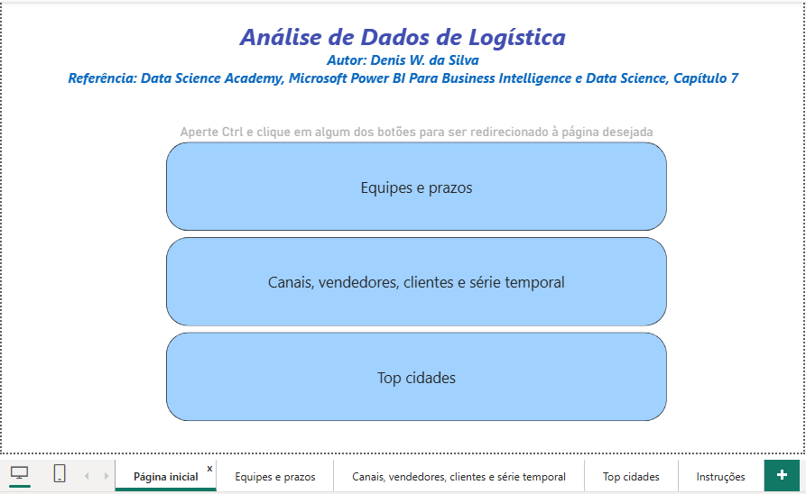
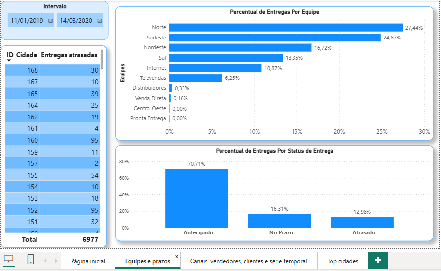
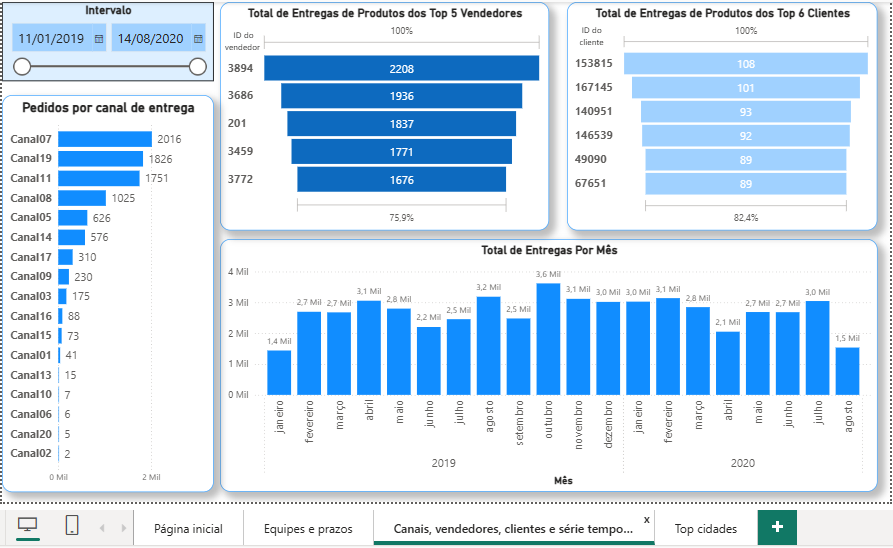
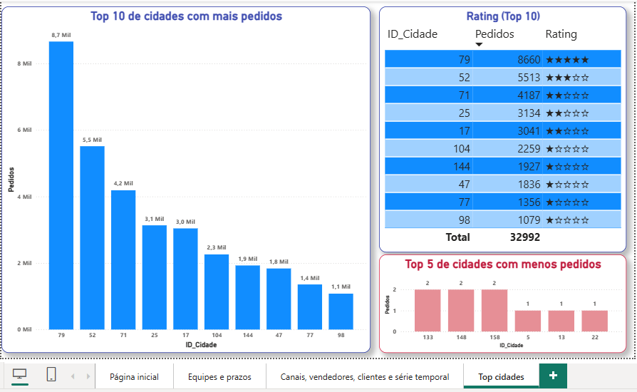

# Análise de Dados de Logística

Relatório desenvolvido por Denis W. da Silva no **Microsoft Power BI** para análise de operações logísticas, explorando o desempenho das equipes de entrega, cumprimento de prazos, canais de distribuição, vendedores, clientes e volume de pedidos por cidade. A elaboração deste projeto foi inspirada no Capítulo 7 do curso _Microsoft Power BI Para Business Intelligence e Data Science_, da Data Science Academy (DSA).

## Visualizações

### 1. Página Inicial

Apresenta a capa do projeto e os botões de navegação que permitem acessar as diferentes páginas de análise.



### 2. Equipes e Prazos

Analisa o percentual de entregas por equipe, a distribuição dos pedidos conforme o status de entrega e a quantidade de entregas atrasadas por cidade. Inclui segmentação interativa por intervalo de datas.



### 3. Canais, Vendedores, Clientes e Série Temporal

Explora o volume de pedidos por canal de entrega, apresenta rankings dos cinco principais vendedores e clientes por quantidade de entregas e acompanha a evolução mensal das entregas ao longo de 2019 e 2020.



### 4. Top Cidades

Apresenta o ranking das dez cidades com maior volume de pedidos, acompanhado de uma classificação visual por estrelas (Rating), além de destacar as cinco cidades com menor quantidade de pedidos.




## Objetivos

O relatório foi desenvolvido para explorar quatro perspectivas de negócio:

- **Equipes e Prazos:** avaliação do desempenho das equipes de entrega e do cumprimento dos prazos estabelecidos.
- **Canais, Vendedores, Clientes e Série Temporal:** análise do volume de pedidos por canal, identificação dos principais vendedores e clientes e acompanhamento da evolução temporal das entregas.
- **Top Cidades:** comparação do volume de pedidos entre cidades, identificação dos principais mercados e classificação visual por desempenho.
- **Navegação e Interatividade:** organização das análises em páginas independentes, com botões de navegação e filtros temporais para exploração dos dados.

## Preparação dos Dados

A preparação dos dados foi realizada no **Power Query**, incluindo:

- Importação do arquivo Excel.
- Seleção da planilha `Logistica`.
- Promoção da primeira linha a cabeçalho.
- Definição dos tipos de dados das colunas, incluindo identificadores numéricos, campos textuais e datas.

## Medidas DAX

Foram criadas as seguintes medidas para analisar o volume de entregas, o cumprimento de prazos e a classificação das cidades:

**Medida – Total_vendas**

```dax
Total_vendas =
    COUNTROWS(Logistica)
```

**Medida – EntregasNoPrazo**

```dax
EntregasNoPrazo =
    CALCULATE(
        [Total_vendas],
        Logistica[Status_Entrega] = "Antecipado" ||
        Logistica[Status_Entrega] = "No Prazo"
    )
```

**Medida – Rating**

A medida `Rating_Melhor` foi desenvolvida para gerar uma classificação visual de zero a cinco estrelas, proporcional ao volume de entregas de cada cidade em relação à maior quantidade observada no contexto dos filtros aplicados.

```dax
Rating_Melhor =
VAR __MAX_NUMBER_OF_STARS = 5
VAR __MIN_RATED_VALUE = 0

VAR __MAX_RATED_VALUE =
    MAXX(
        ALLSELECTED(Logistica[ID_Cidade]),
        CALCULATE(COUNTROWS(Logistica))
    )

VAR __BASE_VALUE = COUNTROWS(Logistica)

VAR __NORMALIZED_BASE_VALUE =
    MIN(
        MAX(
            DIVIDE(
                __BASE_VALUE - __MIN_RATED_VALUE,
                __MAX_RATED_VALUE - __MIN_RATED_VALUE
            ),
            0
        ),
        1
    )

VAR __STAR_RATING =
    ROUND(__NORMALIZED_BASE_VALUE * __MAX_NUMBER_OF_STARS, 0)

RETURN
    IF(
        ISINSCOPE(Logistica[ID_Cidade]),
        IF(
            NOT ISBLANK(__BASE_VALUE),
            REPT(UNICHAR(9733), __STAR_RATING) &
            REPT(UNICHAR(9734), __MAX_NUMBER_OF_STARS - __STAR_RATING)
        ),
        BLANK()
    )
```

A medida foi exibida na tabela com o nome `Rating`. A utilização de `ISINSCOPE` permite apresentar as estrelas nas linhas correspondentes às cidades, mantendo a linha de total geral vazia, evitando uma soma sem significado para essa classificação.

## Arquivos do Projeto

| Arquivo | Descrição |
|---|---|
| `Analise_de_Dados_de_Logistica.pbix` | Arquivo editável do Power BI. |
| `dataset.xlsx` | Base de dados utilizada no relatório. |
| `Instrucoes_Analise_de_Dados_de_Logistica.pdf` | Material de referência do projeto. |
| `print_pagina_inicial.png` | Captura da página inicial. |
| `print_equipes_e_prazos.png` | Captura da análise de equipes e prazos. |
| `print_canais_vendedores_clientes_e_serie_temporal.png` | Captura da análise de canais, vendedores, clientes e série temporal. |
| `print_top_cidades.png` | Captura da análise das principais cidades. |

## Como utilizar

1. Baixe os arquivos deste repositório.
2. Abra `Analise_de_Dados_de_Logistica.pbix` no Power BI Desktop.
3. Para atualizar os dados, abra o Power Query e acesse **Página Inicial → Gerenciar Parâmetros**.
4. Selecione o parâmetro `CaminhoDataset` e substitua o valor pelo caminho completo do arquivo `dataset.xlsx` em seu computador.
5. Confirme a alteração e utilize **Fechar e Aplicar** para carregar os dados.

**Observação:** o arquivo PBIX já contém os dados carregados para permitir a visualização do relatório sem necessidade de configurar o caminho inicialmente. A configuração do parâmetro é necessária apenas para atualizar os dados.