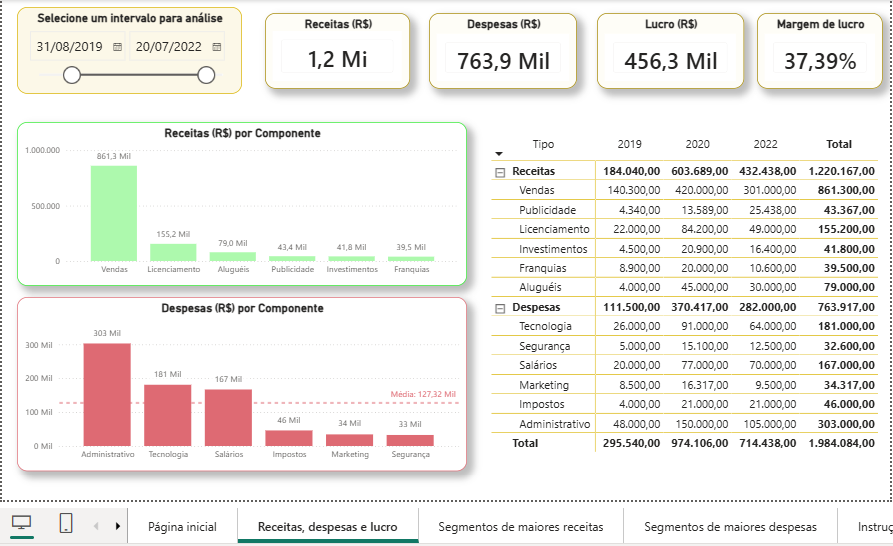
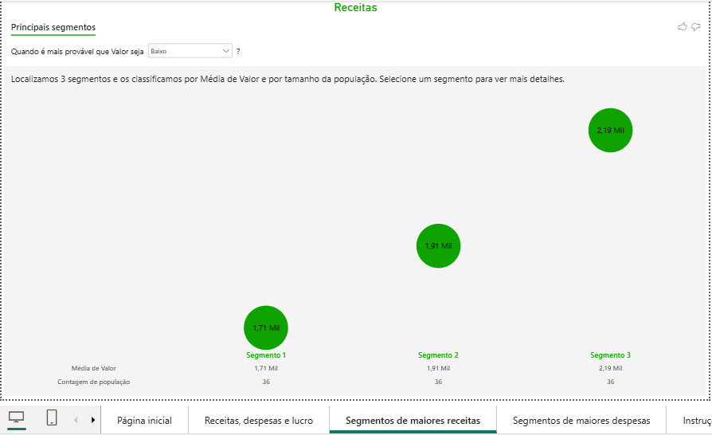
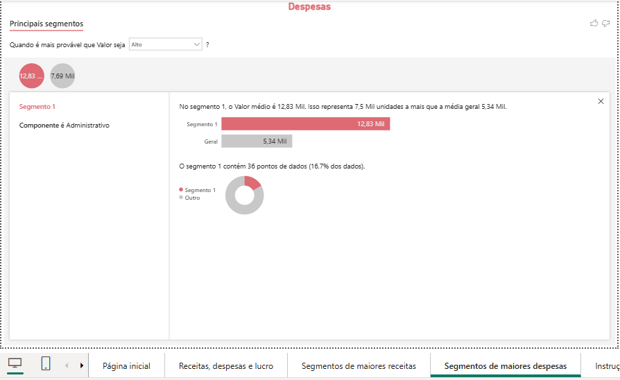

# Análise de Dados Financeiros

Relatório desenvolvido por Denis W. da Silva no **Microsoft Power BI** para análise de receitas, despesas, lucro e margem de lucro, com indicadores financeiros, detalhamento temporal e identificação de segmentos com maiores valores por meio do recurso de IA **Principais Segmentos**. A elaboração deste projeto foi inspirada no Capítulo 8 do curso *Microsoft Power BI Para Business Intelligence e Data Science*, da Data Science Academy (DSA).

## Visualizações


### 1. Página Inicial

Apresenta a capa do projeto e os botões de navegação que permitem acessar as diferentes páginas de análise.


### 2. Receitas, Despesas e Lucro

Painel com segmentador de período para selecionar o intervalo de datas da análise, indicadores de receitas, despesas, lucro e margem de lucro, além de gráficos que apresentam a distribuição dos valores por componente e uma matriz com o detalhamento anual das movimentações financeiras.



### 3. Segmentos de Maiores Receitas

Utilização do recurso de IA **Principais Segmentos** para identificar agrupamentos associados aos maiores valores de receitas. A visualização inicial apresenta os segmentos identificados, permitindo selecionar cada agrupamento para explorar informações adicionais sobre suas características.



### 4. Segmentos de Maiores Despesas

Continuação da análise de segmentação, agora aplicada às despesas. A visualização apresenta o detalhamento de um segmento selecionado, incluindo suas características, quantidade de registros e comparação de seu valor médio com a média geral das despesas.



## Objetivos

- Analisar receitas, despesas, lucro e margem de lucro.
- Comparar receitas e despesas por componente e período.
- Identificar os componentes com maiores valores de receitas e despesas.
- Explorar agrupamentos de dados por meio do recurso de IA Principais Segmentos.
- Desenvolver indicadores e visualizações para apoiar a análise do desempenho financeiro.

## Preparação dos Dados

A preparação dos dados foi realizada no **Power Query**, a partir da planilha `DadosFinanceiros.xlsx`, seguindo as etapas:

- Importação da planilha `DadosFinanceiros` do arquivo Excel.
- Ajuste inicial dos tipos de dados e promoção da primeira linha como cabeçalho.
- Definição dos tipos de dados das colunas, mantendo os campos `Tipo` e `Componente` como texto e as colunas de valores como numéricas.
- Transformação das colunas correspondentes aos meses em linhas por meio da operação **Anular dinamização de outras colunas (Unpivot Other Columns)**, mantendo `Tipo` e `Componente` como identificadores.
- Conversão da coluna `Data` para o tipo data, utilizando a localidade `pt-BR`.

## Medidas DAX

As medidas foram criadas na tabela `DadosFinanceiros`:

**Despesas**
```dax
Despesas =
CALCULATE(
    SUM(DadosFinanceiros[Valor]),
    DadosFinanceiros[Tipo] = "Despesas"
)
```

**Receitas**
```dax
Receitas =
CALCULATE(
    SUM(DadosFinanceiros[Valor]),
    DadosFinanceiros[Tipo] = "Receitas"
)
```

**Lucro**
```dax
Lucro = [Receitas] - [Despesas]
```

**MargemDeLucro**
```dax
MargemDeLucro = DIVIDE([Lucro], [Receitas], 0)
```

## Arquivos do Projeto

| Arquivo | Descrição |
|---|---|
| `Analise_de_Dados_Financeiros.pbix` | Arquivo do relatório Power BI |
| `DadosFinanceiros.xlsx` | Base de dados utilizada no projeto |
| `Instrucoes_Analise_de_Dados_Financeiros.pdf` | Documento com instruções e orientações do projeto |
| `print_pagina_inicial.png` | Captura da página inicial |
| `print_receitas_despesas_e_lucro.png` | Captura da página de receitas, despesas e lucro |
| `print_segmentos_de_maiores_receitas.png` | Captura da página de segmentos de maiores receitas |
| `print_segmentos_de_maiores_despesas.png` | Captura da página de segmentos de maiores despesas |

## Como utilizar

1. Baixe os arquivos deste repositório.
2. Abra `Analise_de_Dados_Financeiros.pbix` no Power BI Desktop.
3. Para atualizar os dados, abra o Power Query e acesse **Página Inicial → Gerenciar Parâmetros**.
4. Selecione `CaminhoDataset` e substitua o valor pelo caminho completo do arquivo `DadosFinanceiros.xlsx` no computador.
5. Confirme a alteração e utilize **Fechar e Aplicar** para carregar os dados.

**Observação:** o arquivo PBIX já contém os dados carregados para permitir a visualização do relatório sem necessidade de configurar o caminho inicialmente. A configuração do parâmetro é necessária apenas para atualizar os dados.