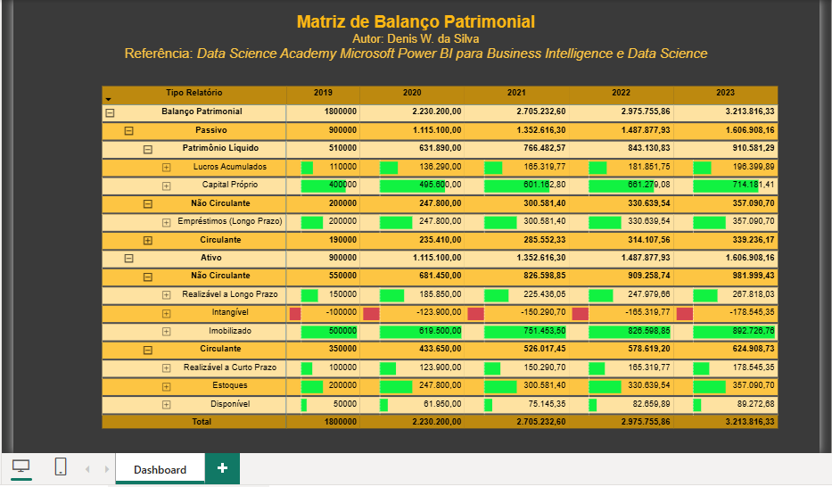

# Balanço Patrimonial

Relatório desenvolvido por Denis W. da Silva no **Microsoft Power BI** para análise da estrutura patrimonial de uma empresa, com organização hierárquica das contas do balanço, acompanhamento da evolução anual dos saldos e destaque visual de valores positivos e negativos. A elaboração deste projeto foi inspirada no Capítulo 9 do curso *Microsoft Power BI Para Business Intelligence e Data Science*, da Data Science Academy (DSA).

## Visualizações

### 1. Dashboard — Matriz de Balanço Patrimonial

Dashboard com matriz financeira expansível, que organiza as contas do balanço em diferentes níveis de detalhamento, abrangendo os grupos de Ativo e Passivo. Permite acompanhar a evolução dos saldos entre 2019 e 2023, com formatação condicional por barras de dados para destacar valores positivos e negativos.

## Objetivos

- Explorar a estrutura hierárquica das contas do balanço patrimonial.
- Analisar a composição dos grupos de Ativo e Passivo.
- Acompanhar a evolução dos saldos ao longo dos anos.
- Utilizar formatação condicional para facilitar a identificação de valores positivos e negativos.
- Construir uma visualização que facilite a análise e interpretação das informações patrimoniais.

## Preparação dos Dados

A preparação dos dados foi realizada no **Power Query**, a partir do arquivo `balanco_patrimonial.xlsx`, composto por duas planilhas:

**Tabela DadosContabeis**
- Importação da planilha `DadosContabeis`.
- Promoção da primeira linha como cabeçalho.
- Definição de `ID_Conta` como número inteiro e das colunas de saldos anuais (`Ano_2019` a `Ano_2023`) como numéricas.

**Tabela PlanoContas**
- Importação da planilha `PlanoContas`.
- Promoção da primeira linha como cabeçalho.
- Definição de `ID_Conta` como número inteiro e das colunas de classificação como texto.

## Modelagem de Dados

Foi estabelecido um relacionamento entre as tabelas `PlanoContas` e `DadosContabeis`, utilizando a coluna `ID_Conta`.

| Propriedade | Configuração |
|---|---|
| Tabela de origem | `PlanoContas` |
| Tabela relacionada | `DadosContabeis` |
| Coluna de relacionamento | `ID_Conta` |
| Cardinalidade | Um para um (1:1) |
| Direção do filtro cruzado | Ambos |

## Arquivos do Projeto

| Arquivo | Descrição |
|---|---|
| `Balanco_Patrimonial.pbix` | Arquivo do relatório Power BI |
| `balanco_patrimonial.xlsx` | Base de dados com as informações do balanço e o plano de contas |
| `Instrucoes_Balanco_Patrimonial.pdf` | Documento com instruções e orientações do projeto |
| `print_dashboard.png` | Captura do dashboard de balanço patrimonial |

## Como utilizar

1. Baixe os arquivos deste repositório.
2. Abra `Balanco_Patrimonial.pbix` no Power BI Desktop.
3. Para atualizar os dados, abra o Power Query e acesse **Página Inicial → Gerenciar Parâmetros**.
4. Selecione `CaminhoDataset` e substitua o valor pelo caminho completo do arquivo `balanco_patrimonial.xlsx` no computador.
5. Confirme a alteração e utilize **Fechar e Aplicar** para carregar os dados.

**Observação:** o arquivo PBIX já contém os dados carregados para permitir a visualização do relatório sem necessidade de configurar o caminho inicialmente. A configuração do parâmetro é necessária apenas para atualizar os dados.