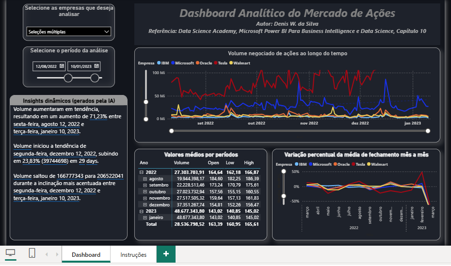

# Dashboard Analítico do Mercado de Ações

Dashboard desenvolvido por Denis W. da Silva no **Microsoft Power BI** para análise do mercado de ações, permitindo comparar o volume negociado e os preços de abertura, fechamento, máxima e mínima de diferentes empresas ao longo do tempo. O projeto utiliza tema escuro personalizado e recursos de visualização interativa, incluindo Narrativa Inteligente. A elaboração deste projeto foi inspirada no Capítulo 10 do curso *Microsoft Power BI Para Business Intelligence e Data Science*, da Data Science Academy (DSA).

## Visualização



## Objetivos

- Comparar o volume negociado de ações de diferentes empresas ao longo do tempo.
- Analisar a evolução dos preços de abertura, fechamento, máxima e mínima.
- Acompanhar a variação percentual mensal dos preços médios de fechamento.
- Identificar tendências, oscilações e períodos de maior volume negociado.
- Explorar informações e insights dinâmicos de acordo com as empresas e o período selecionados.

## Funcionalidades

- **Filtros interativos:** seleção de múltiplas empresas e intervalo de datas para análise comparativa.
- **Narrativa Inteligente:** recurso nativo do Power BI que gera resumos textuais dinâmicos sobre variações, picos e tendências dos dados filtrados.
- **Volume negociado ao longo do tempo:** gráfico de linhas com controle de zoom para comparação do volume diário de ações.
- **Matriz de indicadores por período:** visualização hierárquica por ano e mês das médias de volume e dos preços de abertura, fechamento, máxima e mínima.
- **Variação percentual mensal:** gráfico de linhas que apresenta a evolução da variação percentual da média dos preços de fechamento em relação ao mês anterior.

## Preparação dos Dados

Os dados foram importados de uma planilha Excel (`StockMarket.xlsx`) por meio do Power Query, com as seguintes etapas:

1. Importação da planilha `StockMarket`.
2. Promoção da primeira linha para cabeçalhos.
3. Conversão da coluna `Data` para o tipo data, utilizando a localidade `en-US`.
4. Conversão das colunas `Close`, `Open`, `High` e `Low` para número decimal e da coluna `Volume` para número inteiro.

## Medidas DAX

A medida abaixo calcula a variação percentual da média dos preços de fechamento em relação ao mês anterior, utilizando a função `DATEADD` para recuperar o período anterior.

```dax
Média de Close MoM% = 
IF(
    ISFILTERED('StockMarket'[Data]),
    ERROR("Medidas rápidas de inteligência de tempo somente podem ser agrupadas ou filtradas pela hierarquia de data fornecida pelo Power BI ou pela coluna de data primária."),
    VAR __PREV_MONTH =
        CALCULATE(
            AVERAGE('StockMarket'[Close]),
            DATEADD('StockMarket'[Data].[Date], -1, MONTH)
        )
    RETURN
        DIVIDE(AVERAGE('StockMarket'[Close]) - __PREV_MONTH, __PREV_MONTH)
)
```

## Arquivos do Projeto

| Arquivo | Descrição |
|---|---|
| `Dashboard_Analitico_Mercado_de_Acoes.pbix` | Arquivo do relatório desenvolvido no Power BI. |
| `StockMarket.xlsx` | Dataset utilizado na análise. |
| `Instrucoes - Mercado de Acoes com Narrativa Inteligente.pdf` | Documento com as instruções do projeto. |
| `print_dashboard.png` | Captura de tela do dashboard. |
| `tema-escuro.json` | Arquivo JSON com o tema personalizado utilizado no relatório. |

## Como utilizar

1. Baixe os arquivos deste repositório.
2. Abra o arquivo `Dashboard_Analitico_Mercado_de_Acoes.pbix` no Power BI Desktop.
3. Para atualizar os dados, abra o Power Query e acesse **Página Inicial → Gerenciar Parâmetros**.
4. Configure o parâmetro `CaminhoDataset` com o caminho completo do arquivo `StockMarket.xlsx` em seu computador.
5. Confirme a alteração e selecione **Fechar e Aplicar**.

**Observação:** o relatório já contém os dados carregados. A configuração do parâmetro é necessária apenas para atualizar a fonte de dados.