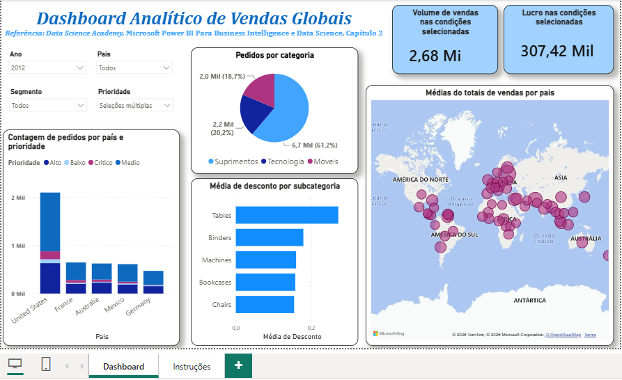

# Dashboard Analítico de Vendas Globais

Dashboard desenvolvido no **Microsoft Power BI** para análise de vendas globais, com indicadores de faturamento, lucro, volume de pedidos e distribuição geográfica das vendas. A elaboração deste projeto foi inspirada no Capítulo 2 do curso _Microsoft Power BI Para Business Intelligence e Data Science_, da Data Science Academy (DSA).

## Visualização

## Objetivos

O dashboard foi desenvolvido para responder às seguintes perguntas de negócio:

1. Qual foi o valor total vendido?
2. Quantas vendas foram realizadas por categoria de produto?
3. Quantas vendas foram realizadas por país, considerando a prioridade de entrega?
4. Qual foi a média de desconto nas vendas por subcategoria de produto?
5. Quais países apresentaram maior média de valor de venda?

## Funcionalidades

- Indicadores de vendas e lucro.
- Análise de pedidos por país e prioridade de entrega.
- Distribuição de pedidos por categoria de produto.
- Análise da média de descontos por subcategoria.
- Mapa geográfico com a média dos valores de venda por país.
- Filtros interativos por ano, país, segmento e prioridade de entrega.

## Preparação dos Dados

A preparação dos dados foi realizada no **Power Query**, incluindo:

- Importação do arquivo CSV.
- Promoção da primeira linha a cabeçalho.
- Definição dos tipos de dados das colunas.

## Arquivos do Projeto

| Arquivo | Descrição |
|---|---|
| `Dashboard_Analitico_de_Vendas_Globais.pbix` | Arquivo editável do Power BI. |
| `Instrucoes_Dashboard_Analitico_de_Vendas_Globais.pdf` | Material original com as instruções do exercício. |
| `print_Dashboard_Analitico_de_Vendas_Globais.png` | Captura de tela do dashboard. |
| `vendas_globais.csv` | Base de dados utilizada no projeto. |

## Como utilizar

1. Baixe os arquivos deste repositório.
2. Abra o arquivo `Dashboard_Analitico_de_Vendas_Globais.pbix` no Power BI Desktop.
3. Para atualizar os dados, abra o Power Query e acesse **Página Inicial → Gerenciar Parâmetros**.
4. Selecione o parâmetro `pCaminhoDataset` e substitua o valor pelo caminho completo do arquivo `vendas_globais.csv` em seu computador.
5. Confirme a alteração e utilize **Fechar e Aplicar** para carregar os dados.

**Observação:** o arquivo PBIX já contém os dados carregados para permitir a visualização do dashboard sem necessidade de configurar o caminho inicialmente. A configuração do parâmetro é necessária apenas para atualizar os dados.

## Ferramentas

- Microsoft Power BI
- Power Query