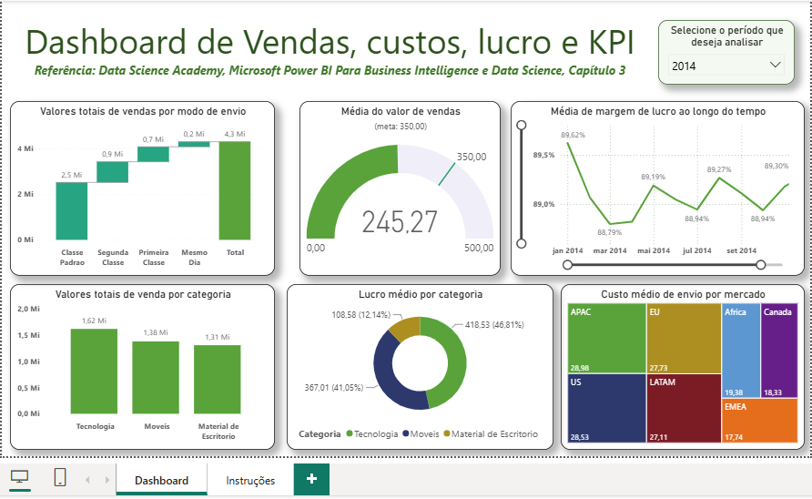

# Dashboard de Vendas, Custo, Margem de Lucro e KPI

Dashboard desenvolvido no **Microsoft Power BI** para análise de desempenho financeiro e operacional, com indicadores de vendas, custos de envio, lucro e margem de lucro.

## Visualização



## Objetivos

O dashboard foi desenvolvido para responder às seguintes perguntas de negócio:

1. Qual foi o valor total de vendas por modo de envio dos pedidos?
2. Quais mercados apresentaram os maiores custos médios de envio?
3. A média do valor de venda ficou acima ou abaixo da meta de 350 em 2014?
4. Qual categoria de produto apresentou o maior lucro médio?
5. Qual foi o comportamento da margem de lucro ao longo do tempo?

## Funcionalidades

- Análise do valor total de vendas por modo de envio, utilizando gráfico de cascata.
- Comparação do custo médio de envio entre mercados, utilizando treemap.
- Indicador KPI para acompanhamento da média do valor de venda em relação à meta de 350.
- Comparação do lucro médio entre categorias de produtos.
- Análise da evolução da margem de lucro ao longo do tempo.
- Filtro interativo por período.

## Preparação dos Dados

A preparação dos dados foi realizada no **Power Query**, a partir de quatro arquivos CSV:

- **Clientes:** definição dos tipos de dados e promoção dos cabeçalhos.
- **Pedidos:** promoção dos cabeçalhos, definição dos tipos de dados e remoção de registros duplicados.
- **Produtos:** definição dos tipos de dados, promoção dos cabeçalhos e remoção de registros duplicados.
- **Vendas:** promoção dos cabeçalhos e definição dos tipos de dados.

## Medidas DAX

Foram criadas as seguintes medidas para os cálculos financeiros:

**Lucro**
```dax
Lucro = 'Vendas'[Valor Venda] - 'Vendas'[Custo Envio]
```

**Margem Lucro**
```dax
Margem Lucro = ROUND(DIVIDE('Vendas'[Lucro], 'Vendas'[Valor Venda]), 4)
```

## Arquivos do Projeto

| Arquivo | Descrição |
|---|---|
| `Dashboard_de_Vendas_Custo_Margem_de_Lucro_e_KPI.pbix` | Arquivo editável do Power BI. |
| `Instrucoes_Dashboard_de_Vendas_Custo_Margem_de_Lucro_e_KPI.pdf` | Material original com as instruções do exercício. |
| `print_Dashboard_de_Vendas_Custo_Margem_de_Lucro_e_KPI.png` | Captura de tela do dashboard. |
| `Clientes.csv` | Base de dados de clientes. |
| `Pedidos.csv` | Base de dados de pedidos. |
| `Produtos.csv` | Base de dados de produtos. |
| `Vendas.csv` | Base de dados de vendas. |

## Como utilizar

1. Baixe os arquivos deste repositório.
2. Abra o arquivo `Dashboard_de_Vendas_Custo_Margem_de_Lucro_e_KPI.pbix` no Power BI Desktop.
3. Para atualizar os dados, abra o Power Query e acesse **Página Inicial → Gerenciar Parâmetros**.
4. Configure os parâmetros `CaminhoDataset_Clientes`, `CaminhoDataset_Pedidos`, `CaminhoDataset_Produtos` e `CaminhoDataset_Vendas`, informando o caminho completo de cada arquivo CSV em seu computador.
5. Confirme as alterações e utilize **Fechar e Aplicar** para carregar os dados.

**Observação:** o arquivo PBIX já contém os dados carregados para permitir a visualização do dashboard sem necessidade de configurar os caminhos inicialmente. A configuração dos parâmetros é necessária apenas para atualizar os dados.

## Ferramentas

- Microsoft Power BI
- Power Query