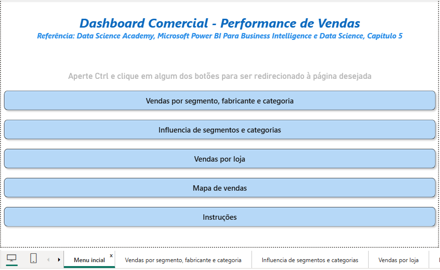
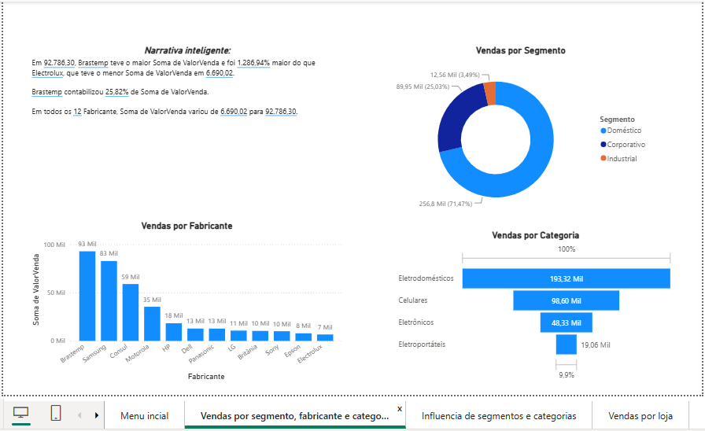
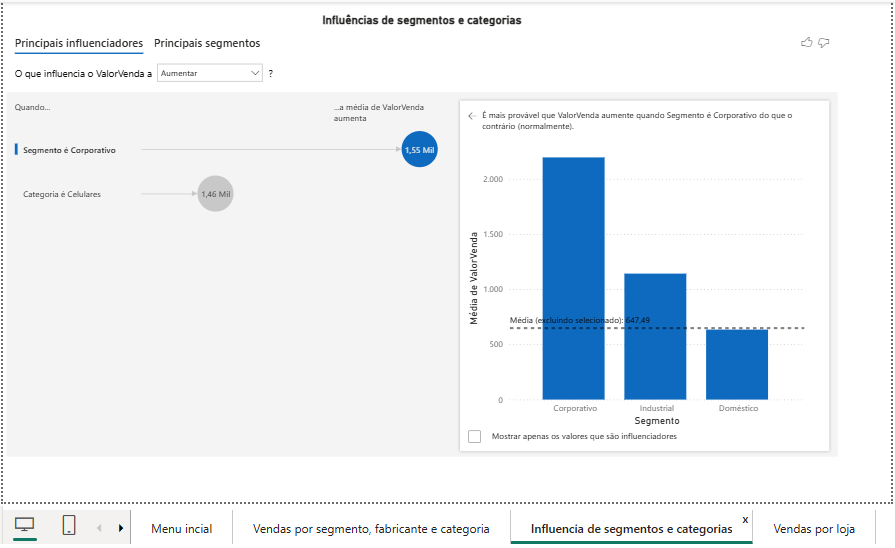
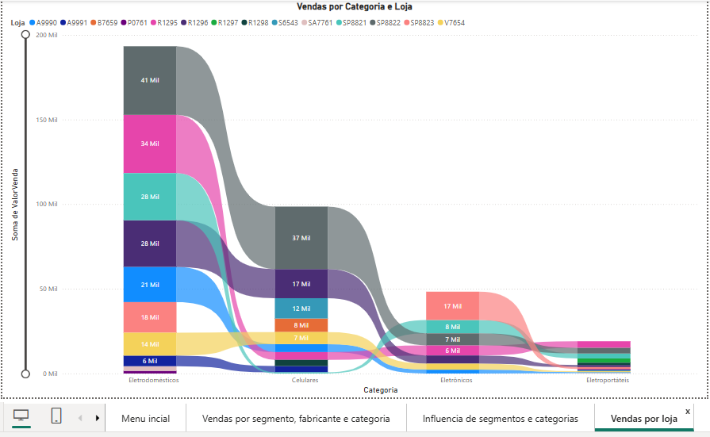
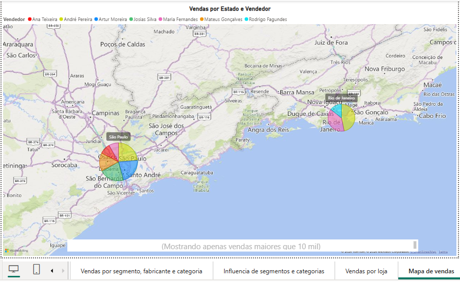

# Dashboard Comercial — Performance de Vendas

Relatório interativo desenvolvido no Power BI para análise da performance comercial de uma empresa, explorando o faturamento por segmento, fabricante, categoria, loja, cidade e vendedor. O projeto utiliza diferentes recursos de visualização e análise, incluindo Narrativa Inteligente, Principais Influenciadores e navegação interativa entre páginas. A elaboração deste projeto foi inspirada no Capítulo 5 do curso _Microsoft Power BI Para Business Intelligence e Data Science_, da Data Science Academy (DSA).

## Visualizações

### 1. Menu Inicial

Página de abertura com botões de navegação que permitem acessar diretamente as quatro páginas analíticas do relatório.

### 2. Vendas por Segmento, Fabricante e Categoria

Análise do faturamento sob diferentes perspectivas, utilizando gráfico de rosca para comparar segmentos, gráfico de colunas para classificar fabricantes e gráfico de funil para visualizar as vendas por categoria. Inclui também o recurso de Narrativa Inteligente, que apresenta automaticamente um resumo dos principais destaques dos dados.

### 3. Influência de Segmentos e Categorias

Utilização do recurso Principais Influenciadores para identificar fatores associados ao aumento do valor das vendas, permitindo explorar a influência de características como o segmento de clientes.

### 4. Vendas por Loja

Gráfico de faixas de opções (Ribbon Chart) para comparar o faturamento por categoria e loja, permitindo observar como a posição de cada loja no ranking varia entre as categorias de produtos.

### 5. Mapa de Vendas

Visualização geográfica das vendas por cidade e vendedor, com gráficos de pizza sobrepostos às localidades para representar a participação de cada vendedor. O mapa considera cidades com vendas superiores a 10 mil.

## Objetivos

- Analisar a distribuição do faturamento entre os segmentos de clientes.
- Comparar o desempenho de vendas por fabricante e categoria de produto.
- Identificar fatores que influenciam o aumento do valor das vendas.
- Investigar a participação das lojas no faturamento de diferentes categorias.
- Explorar a distribuição geográfica das vendas e a atuação dos vendedores.

## Preparação dos Dados

A preparação dos dados foi realizada no Power Query, utilizando a planilha `Dados_Comerciais.xlsx` como fonte.

Principais etapas:
- Importação da planilha `Vendas` do arquivo Excel.
- Promoção da primeira linha a cabeçalho.
- Conversão das colunas para os tipos de dados apropriados, incluindo identificadores e informações textuais, datas e valores numéricos.

## Arquivos do Projeto

- `Dashboard_Comercial_-_Performance_de_Vendas.pbix`: arquivo do relatório Power BI.
- `Dados_Comerciais.xlsx`: conjunto de dados utilizado no projeto.
- `Instrucoes_Dashboard_Comercial_-_Performance_de_Vendas.pdf`: material de referência e instruções do mini-projeto.
- Arquivos PNG: capturas das páginas do relatório.

## Como Utilizar

1. Clone ou baixe este repositório.
2. Abra o arquivo `.pbix` no Power BI Desktop.
3. O relatório já contém os dados carregados, permitindo visualizar as páginas sem precisar atualizar a fonte de dados.
4. Para atualizar os dados, acesse **Transformar Dados → Gerenciar Parâmetros** e configure o parâmetro `CaminhoDataset` com o caminho completo do arquivo `Dados_Comerciais.xlsx` em seu computador.
5. Após configurar o caminho, selecione **Fechar e Aplicar** para atualizar os dados.

## Ferramentas

- Microsoft Power BI
- Power Query
- Microsoft Excel