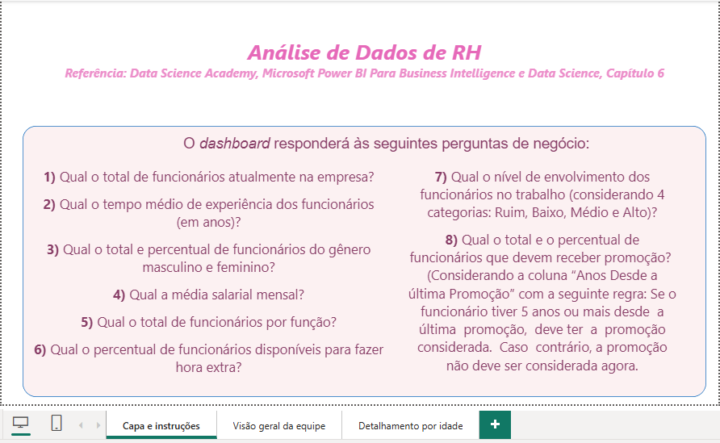
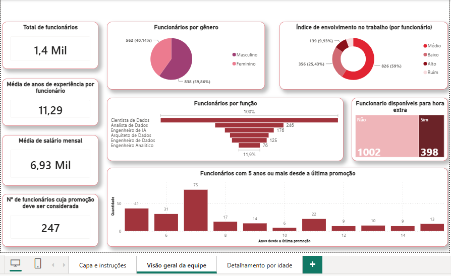
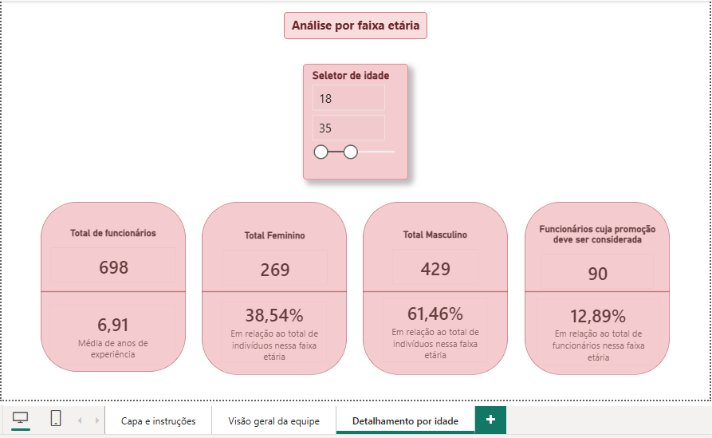

# Análise de Dados de RH

Relatório desenvolvido no Microsoft Power BI para análise do perfil dos funcionários, experiência profissional, remuneração, engajamento no trabalho e elegibilidade para promoção. A elaboração deste projeto foi inspirada no Capítulo 6 do curso _Microsoft Power BI Para Business Intelligence e Data Science_, da Data Science Academy (DSA).

## Visualizações

### 1. Capa e Instruções

Apresenta o escopo do projeto e as perguntas de negócio abordadas pelo relatório.



### 2. Visão Geral da Equipe

Apresenta indicadores gerais dos funcionários, distribuição por gênero, índice de envolvimento no trabalho, distribuição por função, disponibilidade para hora extra e tempo desde a última promoção.



### 3. Detalhamento por Idade

Permite analisar indicadores da equipe conforme a faixa etária selecionada, incluindo quantidade de funcionários, experiência média, distribuição por gênero e elegibilidade para promoção, com valores absolutos e percentuais.



## Objetivos

O relatório foi desenvolvido para explorar três perspectivas de negócio:

- **Capa e Instruções:** apresentação do escopo da análise e das oito perguntas de negócio.
- **Visão Geral da Equipe:** análise do perfil dos funcionários, experiência profissional, remuneração, engajamento, funções e disponibilidade para hora extra.
- **Detalhamento por Idade:** investigação dos indicadores de recursos humanos conforme diferentes recortes etários, incluindo a distribuição por gênero e a elegibilidade para promoção.

## Preparação dos Dados

A preparação dos dados foi realizada no Power Query, incluindo:

- Importação do arquivo CSV.
- Promoção da primeira linha a cabeçalho.
- Definição dos tipos de dados das colunas.
- Substituição dos códigos numéricos da coluna `Indice_Envolvimento_Trabalho` pelas classificações Ruim, Baixo, Médio e Alto.
- Conversão dos valores da coluna `Disponivel_Hora_Extra`, originalmente representados por S e N, para Sim e Não, respectivamente.
- Criação da coluna condicional `StatusPromo`, classificando funcionários com cinco anos ou mais desde a última promoção como "Considerar" e os demais como "Não considerar".

## Medidas DAX

Foi criada uma tabela auxiliar denominada `Medidas` para organização dos cálculos utilizados no relatório.

**Medida – Total_Funcionarios**

```dax
Total_Funcionarios =
    COUNTROWS(DatasetRH)
```

**Medida – Total_Feminino**

```dax
Total_Feminino =
    CALCULATE(
        [Total_Funcionarios],
        DatasetRH[Genero] = "Feminino"
    )
```

**Medida – Total_Masculino**

```dax
Total_Masculino =
    CALCULATE(
        [Total_Funcionarios],
        DatasetRH[Genero] = "Masculino"
    )
```

**Medida – %_Feminino**

```dax
%_Feminino =
    DIVIDE([Total_Feminino], [Total_Funcionarios], 0)
```

**Medida – %_Masculino**

```dax
%_Masculino =
    DIVIDE([Total_Masculino], [Total_Funcionarios], 0)
```

**Medida – Salario_Medio**

```dax
Salario_Medio =
    AVERAGE(DatasetRH[Salario_Mensal])
```

**Medida – ConsiderarPromo**

```dax
ConsiderarPromo =
    CALCULATE(
        COUNTROWS(DatasetRH),
        DatasetRH[StatusPromo] = "Considerar"
    )
```

**Medida – Percentual_Promover**

```dax
Percentual_Promover =
    DIVIDE([ConsiderarPromo], [Total_Funcionarios], 0)
```

## Arquivos do Projeto

| Arquivo | Descrição |
|---|---|
| `Analise_de_Dados_de_RH.pbix` | Arquivo editável do Power BI. |
| `DatasetRH.csv` | Base de dados utilizada no relatório. |
| `Instrucoes_Analise_de_Dados_de_RH.pdf` | Material de referência do projeto. |
| `print_capa_e_instrucoes.png` | Captura da página de capa e instruções. |
| `print_visao_geral_da_equipe.png` | Captura da visão geral da equipe. |
| `print_detalhamento_por_idade.png` | Captura do detalhamento por idade. |

## Como utilizar

1. Baixe os arquivos deste repositório.
2. Abra `Analise_de_Dados_de_RH.pbix` no Power BI Desktop.
3. Para atualizar os dados, abra o Power Query e acesse **Página Inicial → Gerenciar Parâmetros**.
4. Selecione o parâmetro `CaminhoDataset` e substitua o valor pelo caminho completo do arquivo `DatasetRH.csv` em seu computador.
5. Confirme a alteração e utilize **Fechar e Aplicar** para carregar os dados.

**Observação:** o arquivo PBIX já contém os dados carregados para permitir a visualização do relatório sem necessidade de configurar o caminho inicialmente. A configuração do parâmetro é necessária apenas para atualizar os dados.

## Ferramentas

- Microsoft Power BI
- Power Query
- DAX
